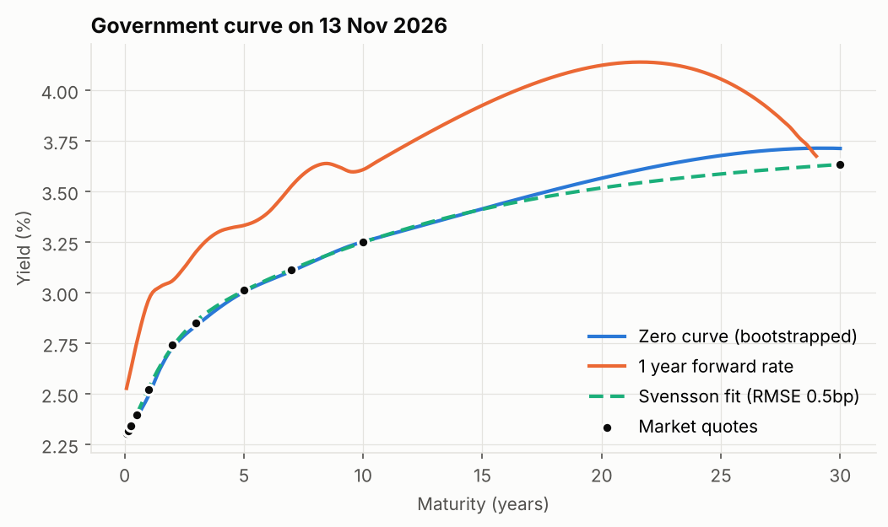
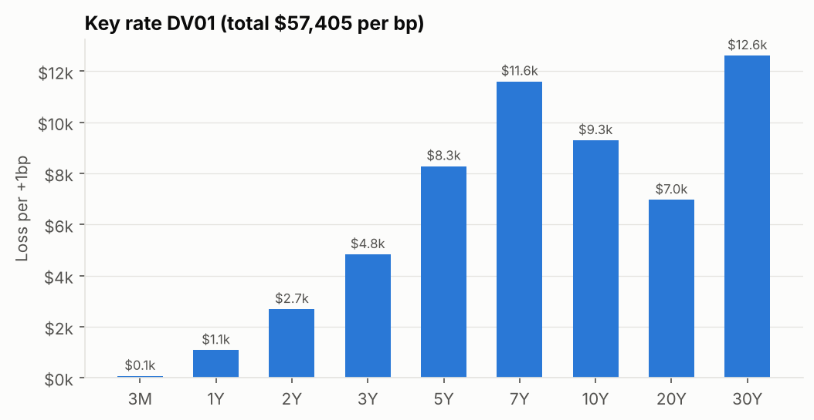
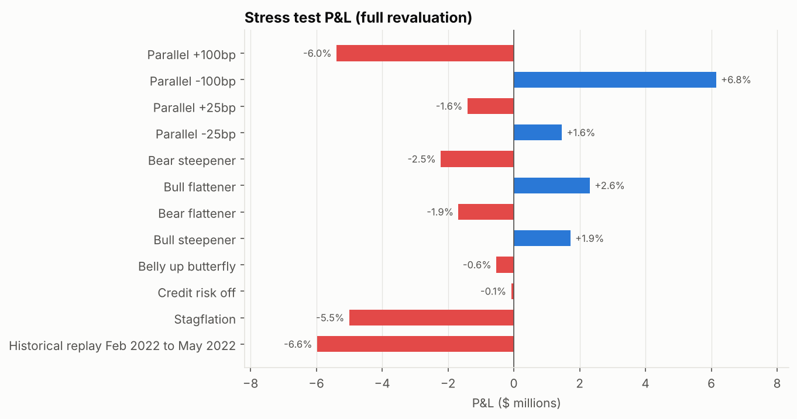
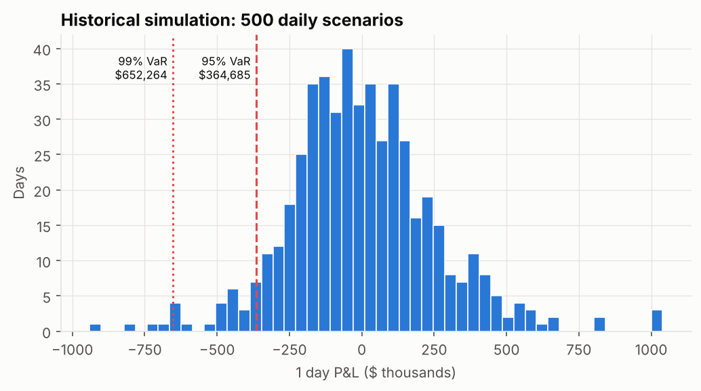
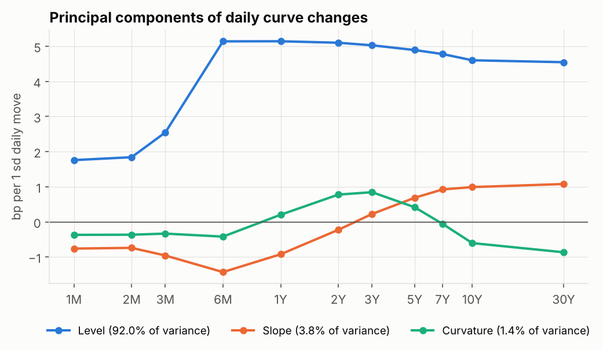
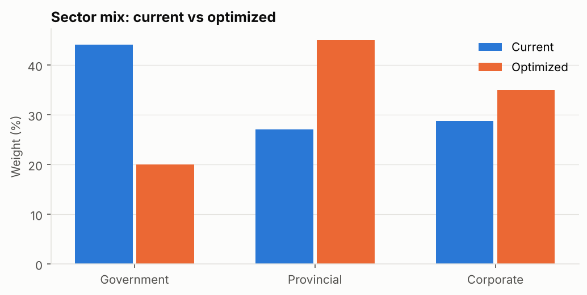

# Fixed Income Risk Analytics

[](https://github.com/YOUR_GITHUB_USERNAME/fixed-income-risk-analytics/actions/workflows/ci.yml)
[](https://YOUR_GITHUB_USERNAME.github.io/fixed-income-risk-analytics/)

An automated pipeline that pulls the Government of Canada yield curve from the Bank of Canada, builds zero and forward curves, prices a bond portfolio, and produces a daily risk report: duration, key rate DV01, stress tests, Value at Risk, principal components of curve moves, and a yield optimizer for portfolio construction.

**Live report:** https://YOUR_GITHUB_USERNAME.github.io/fixed-income-risk-analytics/ (rebuilt every weekday by GitHub Actions)

## Why I built this

Fixed income teams spend a lot of time moving data between spreadsheets, refreshing curves and rebuilding the same risk reports. I wanted to build the full workflow end to end in Python: collect and clean market data, store it, model the curve, measure portfolio risk several ways, and publish the results automatically. Every number in the report is reproducible from code and covered by tests.

## What it does

| Area | Details |
|---|---|
| **Data pipeline** | Bank of Canada Valet API (treasury bills and 2Y to long benchmark bonds), FRED (US Treasuries, ICE BofA corporate spreads). Incremental loads into SQLite, cleaning with a data quality report, offline synthetic sample for testing. |
| **Curve models** | Bootstrapped zero curve from bills and par bonds, forward rates, Nelson Siegel and Svensson fits, dynamic Nelson Siegel (Diebold Li) level, slope and curvature through time. |
| **Bond analytics** | Clean and dirty price, accrued interest, yield to maturity, Macaulay and modified duration, convexity, DV01, effective duration, spread duration, key rate durations, z spread. |
| **Portfolio risk** | Market value, yield, duration and DV01 by holding, sector and rating. Key rate DV01 profile. Duration times spread (DTS) for credit risk. |
| **Stress tests** | Parallel shifts, steepeners, flatteners, butterfly, credit risk off, stagflation, and a replay of the worst historical 3 month sell off found in the data. Full revaluation, split into rates and spread P&L. |
| **Value at Risk** | Historical simulation with full revaluation (every bond repriced on a rebuilt curve for each past day), parametric delta normal VaR, expected shortfall. |
| **PCA** | Principal components of daily curve changes (level, slope, curvature) and the portfolio's P&L for a one standard deviation move in each. |
| **Optimization** | Linear program that maximizes portfolio yield while holding duration, curve bucket exposure and credit risk (DTS) at current levels, with sector, rating and position limits. |
| **Automation** | CLI, HTML report with CSV and JSON extracts, interactive Streamlit dashboard, GitHub Actions for tests and a scheduled daily report published to GitHub Pages. |

## Sample output

The charts below come from the bundled synthetic data set so the repo renders without a network connection. The live report uses real Bank of Canada data. A full sample report is in [docs/sample_report.html](docs/sample_report.html) (download and open in a browser).

| | |
|---|---|
|  |  |
|  |  |
|  |  |

## Quick start

```bash
git clone https://github.com/YOUR_GITHUB_USERNAME/fixed-income-risk-analytics.git
cd fixed-income-risk-analytics
python -m venv .venv && source .venv/bin/activate     # Windows: .venv\Scripts\activate
pip install -e ".[dev,dashboard]"

pytest                                   # 30 tests
fi-risk report --source sample           # offline demo, writes reports/latest/risk_report.html
fi-risk update                           # pull Bank of Canada and FRED data into data/market.db
fi-risk report --source boc              # full report on live Government of Canada data
fi-risk curve --source boc               # print today's curve, zero rates and model fits
streamlit run dashboard/app.py           # interactive dashboard with what if sliders
```

Use your own holdings by passing a CSV with the same columns as `config/portfolio.csv`:

```bash
fi-risk report --source boc --portfolio my_holdings.csv --date 2025-06-30
```

## Project structure

```
src/fixed_income/
  data.py        Bank of Canada and FRED loaders, cleaning, SQLite store
  curves.py      Bootstrapping, zero and forward curves, Nelson Siegel, Svensson, key rate bumps
  bonds.py       Bond pricing, yield, duration, convexity, DV01, KRD, z spread
  portfolio.py   Holding level and portfolio analytics, breakdowns
  risk.py        Stress scenarios, historical and parametric VaR, PCA
  optimize.py    Yield maximization under risk constraints (linear program)
  pipeline.py    End to end analysis
  report.py      Charts and HTML report
  cli.py         Command line interface (fi-risk)
dashboard/app.py Streamlit dashboard
config/          Sample portfolio and investable universe
data/sample/     Synthetic offline data (see scripts/make_sample_data.py)
tests/           Unit tests for pricing math, curves, risk and data handling
.github/         CI and the scheduled daily report
```

## Methods in brief

**Zero curve.** Treasury bill yields are money market (simple) yields, so their discount factor is 1 / (1 + r t). Bond yields are treated as semiannual par yields, interpolated with a monotone cubic (PCHIP) and bootstrapped on a 6 month grid. The resulting curve reprices every quote exactly. Nelson Siegel and Svensson are fitted separately as smooth models and can be used for pricing instead (`--curve-method svensson`).

**Risk measures.** Modified duration and convexity come from the bond's own yield. Effective duration, key rate durations and spread duration come from bumping the curve and repricing, which is the approach that generalizes to bonds with embedded options. Key rate bumps are triangular, so they sum exactly to a parallel shift and the key rate DV01s add up to the total DV01 (checked in the tests).

**VaR.** Historical simulation takes each of the last 500 daily changes in the quoted yields, adds it to today's curve, rebuilds the zero curve and reprices the whole portfolio. This captures convexity and non parallel moves that a duration approximation misses. The parametric version uses tenor level exposures and the covariance of daily changes, which gives a useful cross check.

**Credit.** Canadian corporate spread indices are not freely available, so spread history uses ICE BofA US corporate option adjusted spreads from FRED as a proxy, scaled by sector (provincials at 0.35x). Bond level spreads in the sample portfolio are inputs, not market data.

**Optimizer.** Portfolio yield, duration, key rate exposures and DTS are all linear in market value weights, so the security selection problem is a linear program solved with HiGHS through SciPy. The default run asks: with the same duration, the same short, belly and long exposure, and no more credit risk than today, how much extra yield is available in the universe?

## Limitations and next steps

* Bills and benchmark bonds only. Adding individual Government of Canada bond prices would allow a full fitted curve with rich and cheap analysis by bond.
* The sample corporate issuers are illustrative, and spreads are held constant outside the scenarios.
* Yield weighted optimization ignores transaction costs and turnover; a quadratic program with a turnover penalty is the natural next step.
* Possible extensions: real yield and breakeven inflation from Real Return Bonds, a forecasting model for curve factors, Monte Carlo VaR from the PCA factors, and backtesting VaR breaches.

## Data sources

* Bank of Canada Valet API, Government of Canada treasury bill and benchmark bond yields.
* Federal Reserve Bank of St. Louis (FRED), US Treasury constant maturity yields and ICE BofA corporate index option adjusted spreads.

For research and education only. Not investment advice.
